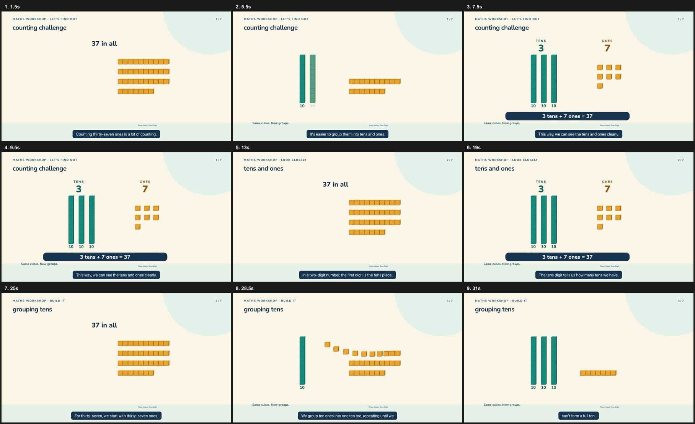
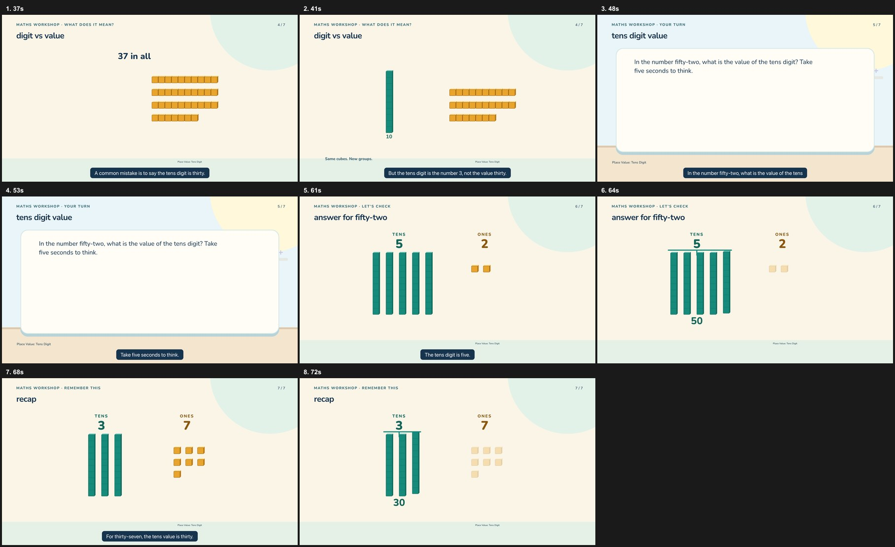
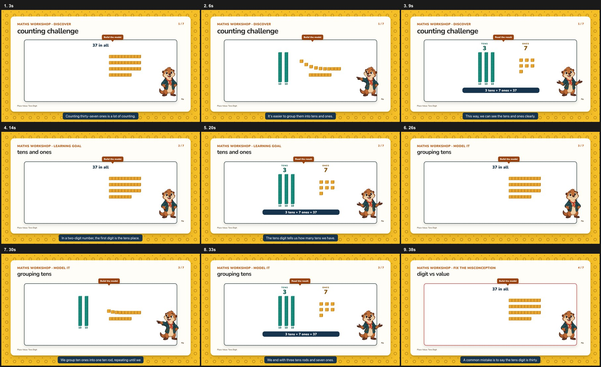
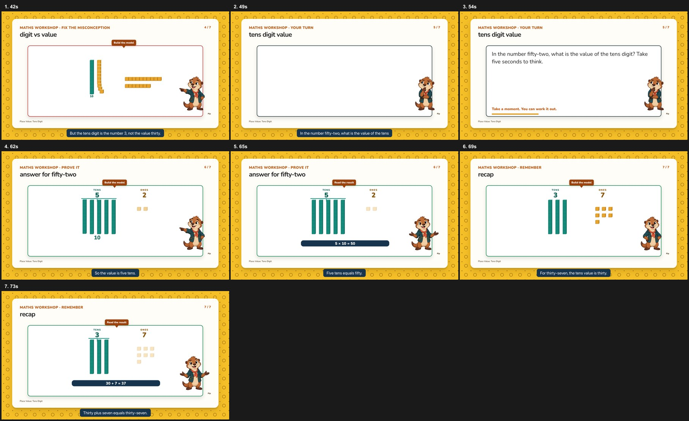
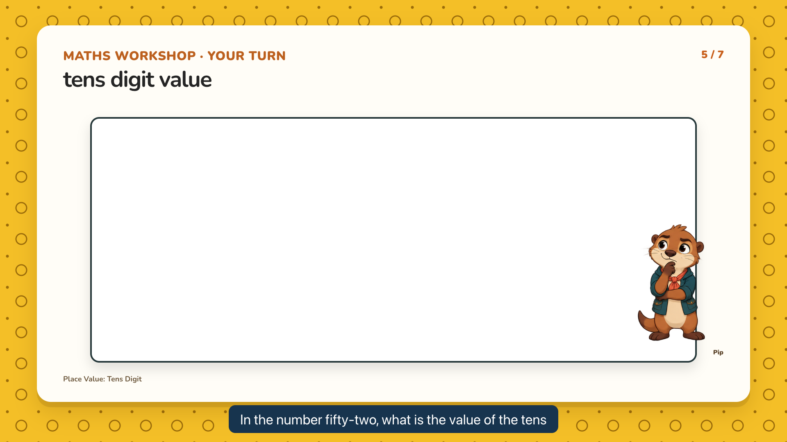
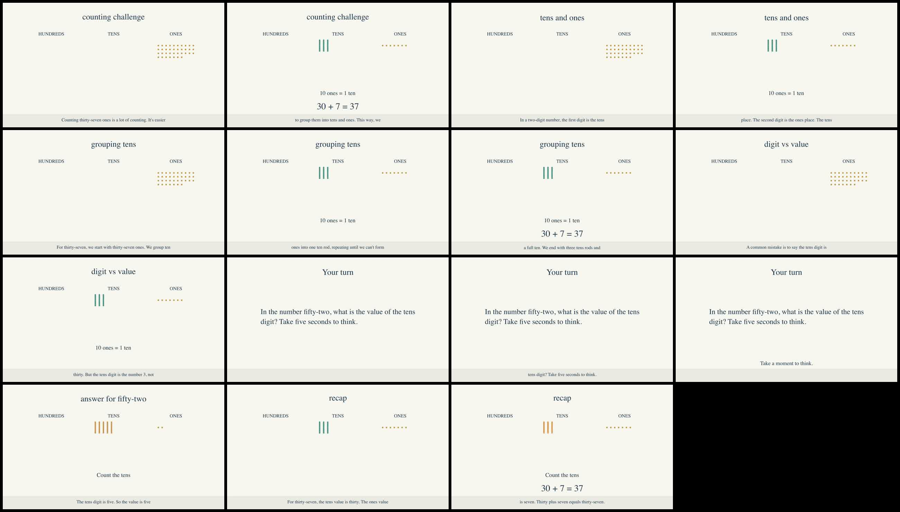
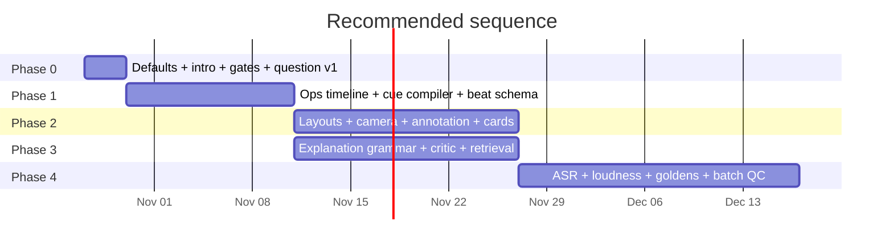

# Best animated, well-explained learning videos — pipeline audit and change plan

Audit date: **2026-10-26**. Basis: full code read of `src/` (with deep dives in
`docs/analysis/`), a fresh frame-by-frame audit of the only real generated lesson
in the repo, two re-rendered compositions of that lesson (default settings and
max-quality settings), the pipeline's own pacing/motion audits, and the 176-test
suite (175 pass, 1 skipped).

> **Verdict.** The instructional control system is genuinely strong and is the
> reason to keep this pipeline. The ceiling is not model quality, visual variety,
> or generated footage. It is four things:
> **(1)** the default configuration is the sparsest one and the best features are
> unreachable from the generator's JSON grammar; **(2)** animation is "three cues
> then a still tail" for every visual kind except base-ten and fraction
> partitioning; **(3)** the frame has one layout and almost no camera or
> annotation language; **(4)** the quality gates that would catch all of this are
> advisory and partly blind.
>
> Fix those four and the existing pipeline produces genuinely good lesson films.
> Adding a 16th static visual kind will not move the result.

Companion deep dives (evidence, file:line citations, extended inventories):

- [`analysis/visual-system.md`](analysis/visual-system.md) — render architecture, 15-kind visual inventory, motion/camera/transition limits, verification blind spots, extension points.
- [`analysis/pedagogy.md`](analysis/pedagogy.md) — lesson schema, plan/critic loop, teaching-principle matrix, register measurements, 14 planner changes.
- [`analysis/audio-timing-qa.md`](analysis/audio-timing-qa.md) — TTS engines, alignment and sync contract, audio design, every automated gate and what it can(not) prove.

---

## 1. How the pipeline works today (and where quality is decided)

```
brief → planner (LLM, strict JSON) → validation (schema/arithmetic/beat arc)
      → same-or-different-model critic → narration (TTS + word alignment)
      → composer → HyperFrames render → ffmpeg audio mix → ffprobe/volumedetect
      → contact sheet + pacing + motion audits → educator review queue
```

There are **three composers**, and which one you get decides most of the quality:

| Route | Selected when | Output | Motion reality |
|---|---|---|---|
| **Film** (`fairFilmCompose`, `src/film.mjs`) | quality mode **or** any `base-ten` scene **or** `avatar:'none'` (`src/composition.mjs:246`) | `index.html` + one sub-composition per scene, 1920×1080 | base-ten gets a real 3-state animation (`src/animation.mjs:38`); **every other visual gets one whole-card fade** (`src/film.mjs:52,64`); question = prompt text + pause bar only |
| **Classic** (`fairCompose`, `src/composition.mjs`) | classic mode + non-`none` avatar + no base-ten | single timeline, 15 visual templates | fraction bars + partition animation; other 13 kinds are entrance fades; 1.5 % scene push |
| **Manim / open-source** (`src/open-render.mjs`) | `generationVersion:'open-source'` | 720p H.264 + Manim `play/wait` | static diagrams, proportional reveals, burned-in captions |

The **film route is now the default in the studio** (`src/server.mjs:128` sets
`generationVersion:'quality'`, `avatar:'none'`), which means most lessons take the
route with the best base-ten animation **but no title card, no music, no
presenter and no question design**. Meanwhile the CLI defaults to `classic`
(`src/plan.mjs:66`) — the opposite of the studio. There is no single "best"
preset, and the two entry points disagree.

### What is genuinely strong (protect this)

- **Measured audio drives the timeline**: every scene's duration comes from the
  rendered narration, not from an estimate (`src/film.mjs:44`), and forced word
  alignment is on in this environment (`FAIR_ALIGNMENT_MODEL_DIR`, `src/voice.mjs:126`).
- **Arithmetic is verified, not trusted**: bounded expression grammar with exact
  rationals (`src/plan.mjs:180-223`), plus a scanner over every `a = b` shown in
  titles/visuals (`:320-329`).
- **Teaching state is computed by the renderer, not the model**: base-ten
  quantities are derived and conserved (`src/base-ten.mjs:4-18`), the fraction
  partition never resizes the shaded amount (`src/partition.mjs`, tested in
  `test/partition.test.mjs`).
- **Structural teaching contract**: 7-beat arc, objective-level explain+practice
  coverage, question→answer adjacency, protected response time
  (`src/plan.mjs:272-284,335-337,342-347`).
- **A review queue with per-job provenance**, contact sheet, quality report, and
  a real test suite (175 passing tests, conservation/property tests included).

Everything below extends that foundation. None of it trades it away.

---

## 2. Fresh measurements (the evidence this plan is based on)

I took the one real generated lesson in the repo
(`.fair-video/cfa9525f-…`, "Place Value: Tens Digit", 7 scenes, 167 words, 75 s),
rebuilt its composition through the current film composer under two
configurations, rendered both, and ran the pipeline's own audits.

The two film renders below reuse the same saved lesson and narration (no new
generation), so every difference between them is composer configuration.

| Measurement | Film path, classic flags (what the CLI renders today) | Film path, quality flags + presenter + title card requested | Manim / open-source (the real job) |
|---|---:|---:|---:|
| Still-picture share of runtime (DOM audit) | **22 %** | 3 % | n/a (no storyboard) |
| Visual changes / minute | 39.1 | 44.7 | 14.3 (derived) |
| Longest frozen interval | 6.34 s (question) | 6.14 s (question) | 12.07 s (question) |
| Frame-diff: frozen seconds | **21 %** | 8 % | 18 % |
| Frame-diff: visibly animated | 78 % | 89 % | 76 % |
| Title card / closing card | **none** | **none** (requested `card`, silently dropped) | none |
| Presenter | none | Pip (static-ish sprite, poses) | none |
| Answer options / countdown ring | none (no options; 7 px bar) | none (no options; 7 px bar) | none ("Your turn", blank) |
| Captions | sentence chunks, styled | sentence chunks, styled | 13 of 20 cues break mid-sentence; burned in **and** embedded |

Default config frames — note the same 37-grouping visual in scenes 1, 2, 3, 4,
and an empty "Your turn" card:





Max-quality config — presenter, semantic pointer labels, 89 % animated, but the
same repeated visual and the same title-less opening:





The question scene in quality mode — **blank card for the first 2.5 s**: the prompt
reveal is word-proportional at 2.51 s (`src/quality-storyboard.mjs:3-12`), and the
pipeline's DOM audit still reports a 6.1 s window without a counted change because
it cannot parse the emitted array-indexed reveal (`tools/teaching-metrics.mjs:24-35`).
The frame audit is what catches it.



The open-source/Manim render of the same lesson — sparse, tiny diagrams, caption
band reading "ones into one ten rod, repeating until we can't form" (a 10-word
caption window cut mid-sentence, `src/open-render.mjs:42`):



Frame-diff audit of the classic-flags film render (the pipeline's own tool):

```
2256 frames · 76s · mean motion 0.514
per second: frozen 16 (21%) · ambient 1 · visible 59 (78%) · strong 51
FAIL  never frozen: 21% of seconds have no visible change (max 10)
PASS  visibly animated: 78% of seconds (min 40)
```

The FAIL line above is recorded in `quality-report.json` as a **warning only** —
`report.passed` is `checks.every(...)` (`src/pipeline.mjs:177`) and the pacing and
motion results are not checks (`:129-139` vs `:153-161`). A lesson with a fifth of
its runtime frozen still reports `passed: true`.

Reproduce:

```bash
# rebuild the film composition from the saved lesson + narration, then render and audit
cp -R .fair-video/cfa9525f-*/project /tmp/recompose/project
node scripts/recompose.mjs /tmp/recompose/project        # writes index.html + scenes/ first,
                                                          # then throws on the film route today (D8)
node node_modules/hyperframes/bin/hyperframes.mjs render /tmp/recompose/project \
  --output /tmp/recompose/lesson.mp4 --fps 30 --quality looks --workers 2 --strict
node tools/teaching-metrics.mjs /tmp/recompose/project
node tools/teaching-metrics.mjs --video /tmp/recompose/lesson.mp4
```

(Reproducing the max-quality comparison: set
`{generationVersion:'quality', avatar:'mira', intro:'card', audio:'music'}` in the
project's `manifest.json` brief before `recompose`.)

---

## 3. Diagnosis — the ten changes that matter

Ranked by learning/presentation impact per unit of work. Each has evidence and an
exact code location.

### D1. The best features are opt-in, and one of them cannot be reached at all

- `avatar:'none'`, `intro:'none'`, `audio:'voice'` are the brief defaults (`src/plan.mjs:71-75`), and the studio labels presentation "Optional · classic lessons only" (`public/index.html:42`).
- `intro.mjs` is imported **only** by the classic composer; `src/film.mjs:1-8` never imports it, so the film route (quality mode, base-ten, `avatar:'none'`) **cannot** render the title/closing card. The pipeline only logs a warning (`src/pipeline.mjs:158`). Verified: recomposing with `intro:'card'` produced 0 intro markup.
- `successStatement` — the child-facing "today we'll be able to…" line the intro card
  reads (`src/intro.mjs:20`) — exists in zod (`src/plan.mjs:87`) but **not in the
  planning JSON schema** (`:137-143`) and **not in any prompt**, so strict decoding
  (`additionalProperties:false`, `:110`) makes it ungeneratable. Generated lessons
  never state success criteria.
- `interaction` (predict / multiple-choice with one correct option) is fully
  implemented in zod (`:97-102`), validation (`:263-271`) and the classic renderer
  (`src/composition.mjs:232-242`) — and is likewise **absent from the planning JSON
  schema** (`:127-132`). Generated lessons can never carry a prediction gate,
  distractors, or diagnostic feedback. The real lesson has `has interaction: false`.

**Effect:** out-of-the-box videos open cold, never state the learning goal, never
ask a question the learner can see, and never reply to a wrong answer.

### D2. The unit of motion is "three cues, then a still tail"

Base-ten is the only visual with a real state machine: objects → transform →
notation (`src/animation.mjs:38-96`), compiled from three authored `spokenBeats`
(`src/plan.mjs:402`). Every other visual is one whole-card fade
(`src/film.mjs:52,64`; `src/composition.mjs:321-324`). Scene length is
`narration + pause + 0.7 s` (`src/film.mjs:44`), so the last third of most scenes is
a still picture under a talking voice. Measured: 1.9–3.6 s tails per base-ten
scene, 6.1 s gap in the question scene, 21 % frozen seconds overall.

The strategy doc's "beat contract" (`docs/teaching-video-strategy.md` §3.2) is the
right fix and is **not implemented**; only the base-ten precursor exists.

### D3. Animation lands on function words, not on meaning

Cue phrases are chosen mechanically as the *longest unique prefix* of each spoken
beat (`src/plan.mjs:34-41`). The real lesson therefore animates its transformation
on **"It's"**, **"But"**, **"The second"**, **"We group"** — and the quality
`wordAnchors` are pure word-count proportions (`src/quality-storyboard.mjs:3-12`),
so a scene's first reveal can fire 35 % into the narration (the 2.5 s blank
question), and its last can fire 0.2 s before the scene ends.

**Effect:** motion feels accidental rather than intentional — it never lands on
the word it illustrates.

### D4. One layout, no camera, no annotation language, no transitions

- Every scene is the same card: kicker / `h1` / workbench / guide / lesson mark at
  fixed pixel positions (`src/film.mjs:26,88`). There are exactly two reframes
  (`closeup`, `question-shot`) and they are CSS classes, not camera moves.
- Camera work in the whole system: a 1.5 % push on the classic route
  (`src/composition.mjs:299-301`), a 1→1.04 push inside the partition engine
  (`src/partition.mjs:160-162`), and a presenters' float. The **film route has no
  scene-root motion at all** (`src/film.mjs:62-84`) — verified by two identical
  snapshots at 7.5 s and 9.5 s in the default render.
- No transitions: hard cuts on `data-start`, plus a whoosh at each cut
  (`src/audio.mjs:107`).
- No arrows, dimension lines, underlines, lassos, or "look here" callouts except
  the quality-mode label pill whose `y` is hard-coded to 238 px (`src/film.mjs:83`).
  The only annotation is text.
- `src/production-plan.mjs:42-45` already defines a camera vocabulary
  (`establishing…insert`, `static/push-in/pull-out/pan/track`) and timed overlays —
  and **nothing imports it**. The intended camera language exists on paper only.

### D5. The question beat has no design surface

Question scenes render narration text only (`src/plan.mjs:411` deliberately hides
the visual; `src/composition.mjs:59`), plus a pause bar in the film route
(`src/film.mjs:79`). Because `interaction` is schema-unreachable (D1), generated
questions have no options, no given-information panel, no countdown ring (the
classic `fairCompose` ring at `src/composition.mjs:400` is not wired into film), and
no answer replay. In quality mode the prompt itself appears late. In the open-source
route the question scene is literally "Your turn" over empty space
(`src/open-render.mjs:23`).

**Effect:** the single moment where the learner should do the cognitive work is
the emptiest frame in the video.

### D6. The plan is allowed to be visually repetitive and pedagogically nominal

Measured on the real lesson (`project/lesson.json`):

- 4 of 7 scenes share the **identical** visual state (`base-ten`, `group`, 37,
  `ones`): hook, concept, example, misconception use the same constructed visual.
- The `misconception` scene reuses the worked example's visual, so "the mistake vs
  the correct idea" is asserted in narration but never *shown* — the prompt even
  forbids numeric wrong work in visuals (`src/plan.mjs:386`).
- The recap restates the worked number ("For thirty-seven, the tens value is
  thirty…") and never states the rule; the rule only exists in `concept.arc`,
  which nothing renders.
- `prerequisites: []`; no activation of prior knowledge, no success criteria, no
  retrieval prompt, no second practice item outside quality mode.
- Narration is a **brisk 153 wpm** (128–173 per scene), 0 uses of "you/your", and
  the concept scene packs six technical terms into 28 words.
- The same-model critic (`src/open-config.mjs:30`; smoke report records
  `criticModel: qwen3:30b`) returned `{"errors":[],"warnings":[]}` while five
  plan-visible defects existed (visual reuse, narration/visual mismatch, no
  contrast, no rule, spoken UI instruction).

### D7. Captions and audio are below the level of the visuals

- Open-source route: captions are fixed 10-word windows (`src/open-render.mjs:42`),
  so 13 of 20 cues break mid-sentence, and they are **burned into the picture and
  also embedded as `mov_text`** (double display; visible in the frame above).
- Why captions are burned in the Manim route also explains the "clipped" look: the
  Manim scene draws the same narration with its own caption logic
  (`scripts/manim-scene.py:180-195`).
- The `audio:'music'` mix is deterministic and well-built (`src/audio.mjs`,
  loudnorm I=-16 at `:222`) but `assets/audio/music-manifest.json` has
  `tracks: []`, so every mix uses the synthesised placeholder. Default is
  narration-only. The best audio is never heard by default.
- Speaking rate is inconsistent across four constants: prompt 2.0 w/s
  (`src/plan.mjs:382`), validator 2.3 w/s (`:338`), OpenAI direction 145 wpm
  (`src/voice.mjs:22`), measured Piper 153 wpm.

### D8. The verification stack proves the file is valid, not that the film teaches

- Pacing and motion results are **warnings**, not gates (`src/pipeline.mjs:160-161`).
- The DOM pacing parser only reads tween statements whose time is a **literal
  number** (`tools/teaching-metrics.mjs:24-35`), so quality-mode array-indexed
  reveals are invisible — verified. The frame audit is the honest number.
- `fairCheckCinematicCandidate` already has black-span and freeze-span detection
  (`src/cinematic-quality.mjs:38-39`) but **is never called by the pipeline**.
- No loudness measurement (only `mean > -60 dBFS`, which a sine wave passes), no
  ASR round-trip, no golden frames, no per-scene screenshots, no `motion.json`
  assertions (HyperFrames supports them; the pipeline emits none).
- Quality-mode "proof" flags are computed from the same plan they validate
  (`src/quality-storyboard.mjs:36-54`), and the music check is hard-coded `true`
  (`src/pipeline.mjs:138`).
- `npm run recompose` crashes on the film route (`composition.audioCues` is
  undefined there, `scripts/recompose.mjs:21`), which slows the layout/timing
  iteration loop that this plan depends on.

### D9. The three routes diverge, and one is a quality cliff

Intro cards exist only in classic. Quality pointer/semantic events exist only in
film. Question design exists best in classic, but classic has the smallest visual
coverage. Manim has the most trustworthy timing/maths data but the sparsest
picture: tiny diagrams, one-line captions, blank question card, no presenter, no
audio design. A feature added to one route silently does not exist in the other
two — which is how D1 happened.

### D10. Only one real generated lesson exists

`.fair-video/` holds one completed lesson; the only quality-mode job failed during
planning on an LM Studio timeout (`b5a3cca0-…/job.json`). Everything about the
quality route is code-level until it is rendered and reviewed. Any change plan
must include producing and reviewing real renders per archetype, or it will be
gradeable only by argument.

---

## 4. Target state

A lesson that passes all of these is "best animated and well explained" in
mechanical terms. Each item maps to a gate in §6.

1. **Every sentence that teaches has a change on screen, and it lands on the word.**
   2–6 beats per scene; one change op per beat; cue word → aligned time; cue error
   p95 ≤ 250 ms.
2. **Nothing is ever static for long and nothing is ever empty.**
   Max frozen gap ≤ 2.5 s, blank-screen seconds = 0, still-picture share ≤ 8 %.
3. **The frame can point.** At least one camera move or annotation callout per
   scene, three real layouts (full-bleed diagram / split / detail close-up), and
   transitions on beat, not on the clock.
4. **The question is a designed object.** Givens visible, 3–4 options with
   diagnostic distractors, countdown ring, and an answer replay that strikes the
   distractors and highlights the correct one. Prompt visible at t = 0.
5. **The plan states the goal, shows the mistake, and generalises the rule.**
   Success criteria card, contrast visual for the misconception, a rule-bearing
   recap, activation of prior knowledge, and one retrieval prompt for later.
6. **The voice and captions are production grade.** 135–145 wpm, sentence-sized
   captions with word-level highlight, ≤ 17 characters/second, measured loudness,
   licence-audited music, and sound effects on change beats.
7. **The gates are real.** A render that fails the motion/pacing/sync/loudness
   checks does not ship as `passed: true`.

---

## 5. The plan

Four phases. Effort is for one experienced engineer with this codebase; impact is
against the measurements in §2.

### Phase 0 — Free wins (2–3 days, biggest ratio)

| # | Change | Where | Expected effect |
|---|---|---|---|
| 0.1 | **One default preset.** Add `brief.preset: 'film' \| 'clean' \| 'open-source'`; `film` = quality + `avatar:'mira'` + `intro:'card'` + `audio:'music'`; make it the default in **both** `server.mjs` and `normalizeBrief`/CLI. Keep "clean canvas" as the explicit alternative. | `src/plan.mjs:66-76`, `src/server.mjs:128`, `public/index.html:41-42` | Both entry points stop producing the sparsest video: CLI leaves the 21 %-frozen classic configuration for the quality one, and both routes gain presenter, music, title and closing cards. Today the studio default is quality + no avatar + no intro + voice-only: 8 % frozen, but still no titles, no presenter, no music, no options. |
| 0.2 | **Wire intro/outro into the film composer.** Import `fairIntroClip`/`fairOutroClip` from `src/intro.mjs`, add them as clips at `start=0` and after the last scene, shift scene starts by `introSeconds`, add the two clips to the root timeline. | `src/film.mjs:33-104` (imports, `:40-47`, `:92-95`) | Title card with success statement + closing rule card on the default route; pipeline warning at `pipeline.mjs:158` becomes obsolete |
| 0.3 | **Make the audits block.** Move pacing/motion into `checks[]` with interim thresholds (still ≤ 15 %, frozen seconds ≤ 5 %, max freeze ≤ 4 s; tighten to the §6 targets once clean), add `hyperframes check --snapshots --at-transitions --frame-check`, and add `freezedetect`/`blackdetect` (`src/cinematic-quality.mjs:38-39`) as a per-render check. Fail on obvious problems; allow `--allow-pacing-warnings` for drafts. | `src/pipeline.mjs:129-139,153-161,177` | Stops shipping visibly frozen renders; makes every later change measurable |
| 0.4 | **Question card v1 (no schema change).** Render the question prompt at `t=0` in a dedicated card, with a real countdown ring (reuse the classic ring, `src/composition.mjs:400`) and the pause bar. Do not use the word-proportional reveal for question prompts; exempt the question scene from `wordAnchors` timing. | `src/film.mjs:51,64,79`, `src/quality-storyboard.mjs:3-12` | Removes the 2.5 s blank start and the static prompt-only window at the pedagogically most important moment |
| 0.5 | **Unblock the grammar: `successStatement` + `interaction`.** Add both to `planningJsonSchema` (`:137-143`, `:127-132`) and to the prompt (`:380-386`). Make `successStatement` required in quality mode; require a `choose` interaction with 3–4 options on every question in quality mode. | `src/plan.mjs` | Unlocks success criteria, prediction gate, distractors, answer feedback — all already implemented downstream |
| 0.6 | **Fix the open-source caption/question parity.** Sentence-aware chunking (reuse `fairCaptionChunks`), drop the burned-in caption layer or the embedded one, render a real question card instead of "Your turn". | `src/open-render.mjs:20-48`, `scripts/manim-scene.py:180-206` | 13/20 mid-sentence captions → 0; question scene no longer blank |
| 0.7 | **Fix small defects.** `scripts/recompose.mjs:21` (`audioCues` optional chaining); duplicate curriculum warning (`src/plan.mjs:622`); word budget uses the measured rate (`* 2` → `* 2.5` at `:382`); sentence-aware CLI default (`classic` → `quality`). | as listed | Iteration loop works; duration targets stop being 25 % off |
| 0.8 | **Ban spoken UI instructions.** Validator: question narration must not contain "take … seconds / moment to think"; the screen carries that instruction, the voice should ask the question. | `src/plan.mjs:272-280` | Removes the register break measured in the real lesson |
| 0.9 | **Verified bugs found during this audit (cheap, do with 0.x).** Partition engine prints a mathematically wrong `×1` scaling badge for equivalent pairs with no integer factor (`2/4 = 3/6`) — `src/partition.mjs:30,81`; interaction cards lose their mini-diagram for any non-fraction option (`src/composition.mjs:39-41,233`); the two base-ten renderers diverge (palette/geometry/wording) for `<100` vs `≥100` (`src/animation.mjs:40` vs `src/discovery.mjs`); `npm test` does not load `.env`, so the only real Manim render test is always skipped. | as listed | Removes three wrong-looking frames and one silently dead test |

### Phase 1 — Make motion measurable and word-anchored (1–2 weeks)

The core refactor, and the enabler for everything after it.

1. **Structured timeline (`src/timeline.mjs`).** Builders return `ops[]`
   (`{selector, from, to, at, duration, ease, kind, target}`) instead of JS
   strings; one serializer emits GSAP. Feed the ops array to `teachingMetrics`,
   `quality-report.json`, SFX placement, and a `motion.json` sidecar. This removes
   the regex parser blind spot (`tools/teaching-metrics.mjs:24-35`).
2. **General cue compiler (`src/cues.mjs`).** Promote `baseTenCueWordOffsets`
   (`src/plan.mjs:151-168`) + `fairCueTimes` (`src/animation.mjs:6-16`) to every
   visual kind and every scene. A beat declares the *content word* it lands on;
   the compiler maps `say → word index → aligned time`. Reject cues that resolve
   to function words.
3. **Beat schema.** `scene.beats = [{ id, say, change: { op, ... }, preserves? }]`
   with validators: `say` occurs exactly once in the narration; ≥ 2 beats per
   teaching scene; ≤ 35 words per beat; ≥ 1 change per 12 words; the change must
   name an object that is on screen (referent check).
4. **Op vocabulary (start small, extend by archetype).** `show`, `bundle(10)`,
   `partition(k)`, `shade(parts)`, `count(values)`, `reveal-notation`,
   `highlight(target)`, `annotate(target, style)`, `focus(target)`, `compare(a,b)`.
   Each op is implemented once and available to any visual kind; geometry comes
   from validated state, never from the model (`src/base-ten.mjs` discipline).
5. **Kill the dead tail mechanically.** For every scene: if the last op ends
   before `speechEnd − 1.2 s`, insert a designed hold — a slow push, count
   emphasis, annotation settle, or presenter beat — never nothing. Gate: max
   frozen gap ≤ 2.5 s.
6. **Fix anchoring sources.** Replace `wordAnchors` proportional timing
   (`src/quality-storyboard.mjs:3-12`) with content-word anchors; stop using the
   longest-unique-prefix trick for teaching cues.

Deliverable acceptance: re-render the real lesson; still-picture ≤ 8 %, max frozen
gap ≤ 2.5 s, cue error p95 ≤ 250 ms (measured against aligned word times), zero
one-shot scenes, and `motion.json` assertions present for every scene.

### Phase 2 — Give the frame a camera and a visual language (2–3 weeks)

1. **Three layouts, chosen by beat/visual:** full-bleed diagram (hook, recap),
   split diagram + annotation column (concept), detail close-up (example,
   misconception contrast, question givens). Replace the fixed card at
   `src/film.mjs:88`; keep the current look as one layout, not the only one.
2. **Camera ops:** `push(1.02–1.06)`, `punchIn(target)` (scale 1.12–1.25 on the
   operated region), `pan(start→end)`, `pullOut` — applied to a transform group,
   emitted as ops, 0.5–0.8 s, `power2.inOut`, never on every scene identically.
   The partition engine's camera group (`src/partition.mjs:160-162`) is the pattern.
3. **Annotation layer:** arrows, underlines, dimension lines, brackets, lasso,
   strike-through, "look here" callouts with a real anchor (not `y:238`). This is
   the cheapest way to make a static diagram *teach*: point at the thing being
   named. Minimal set: `arrow`, `underline`, `bracket`, `strike`, `circle`.
4. **Transitions on beat:** match-cut (same object continuing), dip-to-white, or
   whip-pan, chosen per beat change, keyed to the SFX whoosh. The current
   `continueObjects` hack (`src/film.mjs:50`) becomes one transition style.
5. **Presenter that reacts to events, not to audio energy.** Poses at predict /
   reveal / repair / celebrate, mouth driven by the envelope for sprite poses
   (already partially there), and default on. A static mascot is worse than none.
6. **Question card v2:** given-information panel (the number, the model, the
   diagram — answer-free and validated to be answer-free), 3–4 option cards with
   mini-diagrams where the kind supports it, countdown ring, then answer replay
   with distractors struck and the correct option emphasised (the classic
   composer's `interactionCardsHtml` logic is the reference,
   `src/composition.mjs:232-242`).
7. **Typography and palette tokens.** One scale, a real bundled webfont
   (`Nunito` is referenced with no file today, `src/film.mjs:26`), contrast-checked
   colours, and a caption style that does not compete with the diagram.

### Phase 3 — Upgrade explanation at the planning layer (2–3 weeks)

Schema/prompt work in `src/plan.mjs`, validated against the authored exemplars
already in the repo (`examples/place-value-film.json`,
`scripts/fraction-phase-a.mjs`, `content/decimal-blueprint-test.json`).

1. **Success criteria** required in quality mode; rendered on the intro card.
2. **Prediction gate on the hook:** `predict` interaction, answer withheld until
   the concept scene; the hook's visual must not reveal the transformation.
3. **Misconception as contrast:** `misconception: { claim, whyWrong }` + a
   contrast visual on a shared scale, with the wrong case shown (this requires
   lifting the "no numeric wrong work in visuals" ban for a *marked* contrast
   region — wrongness must be visually marked, e.g. struck/red).
4. **Rule-bearing recap:** `concept.rule` required; the recap narration must share
   key terms with it; the outro card renders it.
5. **CPA ladder per objective:** concrete → pictorial → symbolic, each with its own
   visual kind; validator checks the sequence exists.
6. **Worked → guided → independent:** `support: 'worked'|'guided'|'independent'`
   on example/question scenes; quality mode requires at least one of each and a
   *different* number/representation for the independent item.
7. **Prior knowledge activation:** prerequisite must appear in the hook or an
   activation card; `prerequisites` must be non-empty (or explicitly `[]` with a
   warning).
8. **Cognitive-load limits (deterministic):** ≤ 45 words/scene, ≤ 4 sentences,
   max 18 words/sentence, ≤ 2 new terms per scene, reading level ≤ grade 5.
9. **Register/affect:** require second-person address ("you"), ban spoken UI
   instructions, add one encouragement line per question/answer pair.
10. **Retrieval:** `recallPrompt` + `reviewAfterHours` on the lesson; render
    "Tomorrow: …" on the outro; surface it in the curriculum batch queue.
11. **Independent critic by default:** require a distinct review model or mark the
    job `reviewed-by-same-model`; give its findings `sceneId`s and route them to
    the existing targeted repair path (`src/plan.mjs:550-568`) instead of full
    regeneration.
12. **Non-maths coverage:** add one archetype for process/sequence and one for
    compare/classify (storyboard/frames, not paragraph lists), so non-mathematics
    lessons do not collapse to `steps`. Do this *after* Phases 0–2; it is the
    lowest pedagogical return of anything on this list.

### Phase 4 — Trust, scale, and review economics (ongoing)

1. **ASR round-trip gate:** transcribe the final MP4 with a local model, diff
   against the approved script, fail on dropped/mangled numerals. `hyperframes
   transcribe` exists; a local ASR venv already exists in `.fair-video/`.
2. **Loudness gate:** measure integrated LUFS per render (target −16 ±1), not just
   `mean > −60 dBFS`; per-scene gain normalisation for TTS unevenness.
3. **Music:** add licence-audited beds to `assets/audio/music-manifest.json`
   (`tracks` is empty today) and make `audio:'music'` the default preset.
4. **Golden frames per archetype:** hash the rendered frame at each beat of an
   approved lesson; a refactor that shifts geometry fails loudly. Also enables
   `hyperframes compare` visual review.
5. **Per-scene contact sheet in the review UI:** one frame per beat (the pipeline
   already has `hyperframes snapshot --at`); it catches spoilers and blank frames
   in seconds.
6. **Batch QC dashboard:** per-topic gate status, freeze/pacing/sync trend, and a
   listening-review sampler (the only check that can catch a wrong voice).
7. **Curriculum mapping:** map each topic's `suggestedVisuals` to an archetype and
   *that archetype's required motion*, not to a text card. `steps` is suggested for
   35 of 49 topics today; text cards are exactly where dual coding fails.

---

## 6. Mechanical acceptance gates

Add these to `quality-report.json` and make them blocking (draft mode can override).
Thresholds are deliberately blunt; they catch the failure modes documented here.

| Gate | Threshold | Current measured | Where |
|---|---|---|---|
| Blank-screen seconds (no content on frame) | 0 | 2.5 s at question start | new, per-scene frame audit |
| Max frozen gap (any window without a visual change) | ≤ 2.5 s | 6.34 s (default), 6.14 s (quality) | `tools/teaching-metrics.mjs` GATES |
| Frame-diff frozen seconds | ≤ 2 % | 21 % / 8 % | `motionMetrics` |
| Still-picture share of runtime | ≤ 8 % | 22 % / 3 % | `teachingMetrics` |
| One-shot scenes | 0 | 0 for base-ten; 13/15 kinds are one-fade | `teachingMetrics` |
| Cue-to-word error | p95 ≤ 250 ms | unknown (estimated for non-base-ten) | new sync audit |
| Content changes per minute | ≥ 20 | 39 / 45 (but concentrated in base-ten) | `teachingMetrics` |
| Distinct visual states per lesson | ≥ 0.7 × scenes | 4 of 7 identical | new plan validator |
| Question prompt visible at scene start | 100 % | 0 % (revealed at 2.5 s) | new DOM/frame check |
| Question has visible options | 100 % in quality | 0 % | new plan validator + renderer |
| Misconception visual differs from example visual | required | violated | new plan validator |
| Recap states the rule | required | violated | new plan validator |
| Narration rate | 120–145 wpm | 153 wpm | `voice.mjs` rate control + gate |
| Caption cue breaks on sentence boundary | 100 % | 65 % mid-sentence on Manim route | `fairOpenCaptions` |
| Caption reading speed | ≤ 17 chars/s | unmeasured | new gate |
| Integrated loudness | −16 LUFS ±1 | unmeasured (`mean > −60 dBFS` only) | new `ebur128` gate |
| ASR script fidelity | ≥ 98 % tokens + all numerals | none | new ASR gate |
| Pacing/motion/sync gates | blocking | advisory warnings | `src/pipeline.mjs:129-177` |

---

## 7. Order of work — if you do only three things

1. **Phase 0.1–0.3** (default preset + intro wiring + blocking gates). One to two
   days. Ends the situation where the studio default is quality mode but still has
   no title card, no presenter and no music, the CLI default is the weaker classic
   configuration, and a render with 21 % frozen seconds reports `passed: true`.
2. **Phase 1.1–1.2** (ops timeline + general cue compiler). The structural fix.
   Without it, every scene but base-ten keeps animating on the wrong word and no
   amount of content work shows on screen.
3. **Phase 0.5 + 2.6 + 3.3** (unblock `interaction`/`successStatement`, build the
   question card, show the misconception as contrast). This is the learning-science
   delta: a learner who can see the question, answer it, get feedback, and see the
   mistake they would make learns more than from any camera move.

Everything else is sequencing and polish.



Phase 3 can run in parallel with Phase 2 because it touches `src/plan.mjs` only;
Phase 0.5 should land first because the renderer support already exists.

---

## 8. What not to do

- **Don't add more static visual kinds.** Fifteen exist; thirteen are entrance
  fades. A sixteenth multiplies surface area without adding a beat. (The strategy
  doc says this too; this audit confirms it with the 13/15 number.)
- **Don't chase diffusion footage or lip sync.** The evidence in
  `docs/teaching-video-strategy.md` §9.1 (MiniMax H3 / LTX 2.5 / Wan) stands:
  diffusion can illustrate, not demonstrate. Deterministic geometry keeps sole
  responsibility for correctness-critical motion.
- **Don't make the planner smarter before the beat layer.** Better prose over a
  frozen diagram is still a frozen diagram.
- **Don't LLM-judge aesthetics.** Keep the critic for facts, adjacency and
  coverage; gate visuals/timing on geometry and measurements; keep the educator
  for taste.
- **Don't remove the review queue** for throughput. It is why the output is
  classroom-usable.
- **Don't trust the quality-mode proof booleans.** They are computed from the plan
  they validate (`src/quality-storyboard.mjs:36-54`). Replace them with frame/
  timeline evidence or label them as metadata assertions.

---

## 9. What this changes in expected quality

Using the dimensions from the repo's own KooBits comparison
(`docs/teaching-video-strategy.md` §6), and the measurements in §2:

| Dimension | Now | After Phase 0 | After Phase 1–2 | After Phase 3 |
|---|---:|---:|---:|---:|
| Animation explanation | 6.0 | 6.5 | 8.0 | 8.5–9.0 |
| Visual variety | 5.0 | 5.5 | 7.5 | 8.0 |
| Question / learner interaction | 3.0 | 5.0 | 8.0 | 8.5 |
| Real-world hook | 5.0 | 5.5 | 6.5 | 8.0 |
| Presentation + animation | 6.1 | 7.2 | 8.2 | 8.5 |
| Teaching architecture | 8.6 | 8.8 | 8.8 | 9.0 |
| Frozen-second share (measured) | 21 % / 8 % | ≤ 8 % | ≤ 2 % | ≤ 2 % |

These are estimates for prioritisation, not promises. The measured columns are
the only ones that are evidence.

---

## 10. Evidence index and reproduction

**Primary artefacts**

| Evidence | Path |
|---|---|
| Real generated lesson (open-source route) | `.fair-video/cfa9525f-17d6-418b-8762-7005b905ee36/project/{lesson,narration,quality-report}.json` |
| Its rendered video | `.fair-video/cfa9525f-17d6-418b-8762-7005b905ee36/project/lesson.mp4` |
| Failed quality-mode job | `.fair-video/b5a3cca0-…/job.json` |
| Default film-path frames | `docs/analysis/evidence/film-default-sheet-{1,2}.jpg` |
| Max-quality film-path frames | `docs/analysis/evidence/film-quality-sheet-{1,2}.jpg` |
| Blank question frame | `docs/analysis/evidence/film-quality-question-blank-49s.png` |
| Manim route frames | `docs/analysis/evidence/manim-opensource-contact.jpg` |
| Frozen-tail frame | `docs/analysis/evidence/film-default-frozen-tail-9.5s.png` |

**Code anchors used most**

| Claim | Location |
|---|---|
| Composer dispatch | `src/composition.mjs:245-246` |
| Film route features (no intro, base-ten-only animation, question card) | `src/film.mjs:1-8,44,50-52,64,79,88,92-95` |
| Base-ten 3-phase animation | `src/animation.mjs:38-96` |
| Generic entrance reveal | `src/composition.mjs:321-324` |
| Quality word-proportional anchors | `src/quality-storyboard.mjs:3-12` |
| Success criteria / interaction schema blockers | `src/plan.mjs:87,97-102,127-132,137-143` |
| Cue prefix selection | `src/plan.mjs:34-41,151-168` |
| Question visual hidden | `src/plan.mjs:411` |
| Pacing/motion advisory warnings | `src/pipeline.mjs:129-139,153-161,177` |
| Manim caption chunking (10 words) + question drop | `src/open-render.mjs:20-48` |
| DOM tween parser (literal times only) | `tools/teaching-metrics.mjs:24-35` |
| Freeze/black detection available but unused | `src/cinematic-quality.mjs:38-39` |
| Music manifest empty | `assets/audio/music-manifest.json:17` |
| Unused camera vocabulary | `src/production-plan.mjs:42-45` |

**Commands**

```bash
npm test                                              # 176 tests, 175 pass, 1 skipped
node tools/teaching-metrics.mjs <projectDir>          # DOM/pacing audit
node tools/teaching-metrics.mjs --video <mp4>         # frame-motion audit
node scripts/recompose.mjs <projectDir>               # rebuild composition only (crashes on film route today)
node node_modules/hyperframes/bin/hyperframes.mjs snapshot <dir> --at 3,10,20 --no-end
node node_modules/hyperframes/bin/hyperframes.mjs check <dir> --json
```

**Conventions.** Measured = produced by a tool in this repo or `ffprobe`/`ffmpeg`
on a render in this repo. Inferred = judgement about learning or aesthetics, marked
as such in the companion deep dives. The companion reports tag every claim `[V]`
verified / `[M]` measured / `[I]` inferred.
